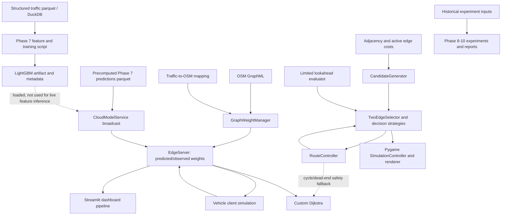

# GeoPulse Complete Project Audit and Development Readiness

**Audit date:** 22 November 2026  
**Repository:** GeoPulse  
**Branch at audit start:** `main`, at `origin/main`  
**Purpose:** Record the repository's observed state, safe cleanup, verified repairs, and development gaps before Phase 2.

## 1. Audit scope and evidence

The audit enumerated the repository recursively, including tracked and untracked files, and inspected the source, tests, scripts, data, model artifacts, reports, generated outputs, and Git state. It found 513 files outside `.git`, `.venv`, and the inaccessible `.pytest_cache` before cleanup. The final count is summarized after cleanup in the cleanup manifest. All 63 Python source modules, 8 scripts, and 7 test modules were inventoried; routing, model, data, simulation, dashboard, and experiment paths were read and traced.

No separate original synopsis file was found in the repository or the supplied attachment. The original synopsis requirements below are taken from the synopsis summary included in the user's audit request. A native WebSocket, Redis, PostGIS, FastAPI, Leaflet, or Docker deployment implementation was not found by source or configuration search.

The repository contained user edits to `src/routing/route_controller.py` and `src/routing/two_edge_selector.py` before this audit. Those edits were reviewed and carried forward into the repairs. No Git commit or push was performed.

## 2. Project goal and scope distinction

GeoPulse is a local research prototype for traffic-aware routing over OSM graphs. Its original synopsis describes a small, simulated deployment with vehicle telemetry, buffering, a geospatial database, a route API, map display, and Docker Compose. Those deployment components remain distinct from the later research contributions:

- LightGBM next-hour road-segment speed prediction.
- Conversion of predicted speed into travel-time edge costs.
- Sequential Two-Edge Selection at intersections, with greedy, destination-aware, lookahead, and adaptive strategies.
- Comparison against Dijkstra and A* baselines.

The two-edge selector remains the intended primary algorithm. Dijkstra is used as a baseline and as a safety recovery path after a dead end or a detected cycle.

## 3. Observed architecture



The Streamlit and Edge/Vehicle prototype uses direct Python calls. Pygame invokes `TwoEdgeSelector` directly. It does not call `RouteController`, so it does not inherit that controller's cycle, dead-end, or threshold-gating behavior.

## 4. Repository structure

The project has these top-level areas. File counts and exact removals are recorded in the cleanup manifest.

```text
.
├── data/                 processed traffic-to-OSM mappings and Bhubaneswar OSM graph
├── datasets/             canonical traffic table and Jaipur OSM graph/tables
├── docs/                 data, algorithm, methodology, phase, and visualization reports
├── geopulse smartroute/  archived dataset package and two distinct historical reports
├── models/               LightGBM joblib model and feature metadata
├── notebooks/            Bhubaneswar notebook and preserved OSMnx response cache
├── outputs/              dataset, routing, and exploratory audit outputs
├── results/              Phase 7-11, two-edge experiment, and dashboard run artifacts
├── scripts/              training, replay, evaluation, dashboard, demo, and presentation entrypoints
├── src/
│   ├── cloud/            model service
│   ├── dashboard/        scenario backend, state, and visualizations
│   ├── demo/             Phase 9 demo
│   ├── edge/             edge server, messages, and maps/timelines
│   ├── experiments/      benchmark runner and experiment figures
│   ├── phase10/          ablation, robustness, leakage, statistics, and figures
│   ├── pygame_simulation/ scenario manager, controller, renderer, sprites, and UI
│   ├── routing/          graph costs, Dijkstra/A*, two-edge routing, and rerouting
│   ├── simulation/       simulated vehicle client
│   └── audit_*.py        dataset and routing-network audit entrypoints
└── tests/                routing, rerouting, model/edge integration, dashboard, and Pygame tests
```

There are no root dependency, packaging, Docker Compose, or pytest configuration files in the original tree. This audit added a pinned `requirements.txt` and a root `.gitignore`.

## 5. Data and road-network pipeline

| Asset | Observed contents | Audit result |
|---|---|---|
| `datasets/traffic_structured_v1.parquet` | 275,800 rows × 17 columns; 700 traffic segments | Loaded successfully |
| `datasets/traffic_v1.duckdb` | `traffic` table, 275,800 rows, 17 columns | Opened read-only and queried successfully |
| `data/processed/traffic_to_osm_mapping_final.parquet` | 700 rows × 16 columns; 599 `DYNAMIC`, 92 `DYNAMIC_BIDIRECTIONAL`, 9 `STATIC_FALLBACK` | Loaded successfully |
| `data/raw/osm/bhubaneswar_drive.graphml` | 18,260 nodes and 46,679 directed edges | Loaded successfully |
| `datasets/jaipur_osm/jaipur_graph.graphml` | 79,355 nodes and 208,272 directed edges | Loaded successfully; not the primary routing graph |

`GraphWeightManager` builds directed adjacency, lengths, static speeds, and static travel-time costs. Mapped segment speeds are clipped to 3–120 km/h, combined by arithmetic mean where multiple sensors map to an edge, and copied symmetrically to reverse OSM arcs only for `DYNAMIC_BIDIRECTIONAL` mappings. Unmapped and static-fallback edges keep OSM-derived static costs. `calculate_travel_time_seconds` uses length divided by speed in metres per second and has a 3 km/h floor.

Pygame's OSM scenario loader and the dashboard use the Bhubaneswar graph and mapping. The source also contains a Jaipur graph and CSVs; they are not consumed by the main dashboard path. The three files under `notebooks/cache/` are preserved: the phase 2 report identifies them as the OSMnx response cache used to reproduce the graph topology. They are not Python bytecode caches.

## 6. LightGBM implementation

`scripts/train_phase7_speed_predictor.py` reads the structured traffic table and mapping, builds temporal features, six lag features, rolling statistics, current/free-flow speed and road metadata, and trains a 25-feature LightGBM regressor for the next-hour speed target. The trained artifact is `models/speed_predictor.joblib`; its feature and training metadata are in `models/feature_metadata.json`.

The saved Phase 7 test metrics report 30,800 test rows. LightGBM has MAE 0.934 km/h, RMSE 1.6005 km/h, and R² 0.9679. The saved historical baseline is stronger on this test split (MAE 0.8354, RMSE 1.5680). On the saved peak subset, LightGBM MAE is 1.3634 km/h versus 1.3497 for the historical baseline. These are stored historical results; the training script was not rerun in this audit.

`CloudModelService` successfully loads the LightGBM file and reads its metadata. Its broadcast method selects `predicted_speed` rows from `results/phase7_predictions.parquet`; it does not call `model.predict`. That parquet contains prediction outputs and evaluation columns, not the 25 model input features. A direct `model.predict` attempt using its columns failed with a `KeyError` for the missing feature columns. This is an inference-pipeline integration gap, not a dependency failure.

**Status:** model artifact load and stored prediction broadcast are verified; live feature construction and inference are partial.

## 7. Two-Edge Selection: actual behavior

The execution path is:

1. `RouteController.execute_journey` calls `TwoEdgeSelector.decide_next_edge` at the current node.
2. `CandidateGenerator` reads the node's outgoing `(neighbor, key)` edges and gets costs from active travel-time weights. Missing candidate weights default to 10 seconds; the graph cost builder normally supplies weights for all OSM edges.
3. If the previous node is one of multiple outgoing choices, its immediate reversal is pruned. If it is the only exit, it remains available.
4. Zero eligible outgoing edges is a dead end; one is a forced continuation; two are used as the natural pair; more than two are reduced to two candidates by the selected generation policy.
5. The decision strategy compares the candidate pair. Greedy uses immediate travel time; destination-aware uses immediate time plus a straight-line Haversine estimate; lookahead evaluates a bounded forward search; adaptive chooses destination-aware or lookahead based on candidate speed.
6. The controller advances the chosen edge and repeats at the next intersection.

Therefore, **the implementation evaluates two alternatives at a choice point, but does not always evaluate exactly two**: dead ends have zero candidates and forced continuations have one. When out-degree is greater than two, the generator chooses two candidates; at out-degree two, both are natural candidates. Traffic predictions affect selection through the active speed-derived travel-time weights. `edge_speeds` also affect adaptive strategy choice and display.

Visited nodes receive a strategy penalty, and immediate reversal is pruned when another exit exists. A two-edge choice can still lead into a cycle. The controller detects repeated nodes against `max_node_visits`; it first tries a shortest-path fallback. Once a cycle fallback is selected, it now follows the remaining Dijkstra subpath through to the destination instead of returning to local selection at the next node. On a dead end, it tries a forward path, then a real reverse arc of any lane key, then a synthetic reverse traversal along the edge just used.

Lookahead had two verified defects: the selector imported decision-strategy classes from the wrong module, and the one-argument candidate-ranking callback omitted the destination argument. The decision evaluator could also retain stale weights after an update. The import, callback, adaptive strategy refresh, and current-weight refresh are repaired and covered by a new test with three outgoing edges.

The destination heuristic uses a configured 25 km/h free-flow speed. Since the model permits speeds up to 120 km/h, the straight-line estimate is not guaranteed admissible for all roads. The sequential algorithm is local and does not guarantee the global shortest path.

### Real-network check

On the canonical Bhubaneswar O-D pair `3722327026 → 2443921849`, using the stored prediction broadcast for `2026-01-15 14:00 UTC`, baseline Dijkstra reached the destination in 74 edges. The repaired destination-aware sequential controller reached it in 98 decisions, with one cycle recovery; 78 decisions followed the Dijkstra recovery path. The recorded simulated route time was 1,591.57 seconds. This is a current code-path spot check, not a benchmark aggregate, and it shows that real-network completion still relies heavily on safety fallback.

The existing `results/two_edge_experiments/master_algorithm_comparison.csv` is a historical artifact from before this repair. Its first O-D row shows the Greedy, Destination-Aware, Lookahead-2, and Sequential+Dynamic runs failing at 225 hops. It was not regenerated during this audit, so its sequential numbers must not be presented as current post-fix results.

## 8. Routing modules and dependencies

| Module | Role and dependencies | Integration and verification |
|---|---|---|
| `src/routing/candidate_generator.py` | Outgoing-edge generation, reversal pruning, heuristics, and top-two candidate policies | Used by selector, controller, Pygame, and benchmark runner; unit-tested |
| `src/routing/decision_strategies.py` | Greedy, destination-aware, limited-lookahead, and adaptive pair comparison | Used by selector and Pygame; unit-tested |
| `src/routing/lookahead.py` | Bounded forward search with cycle avoidance and expansion limit | Used by lookahead strategy and candidate ranking; unit-tested after repair |
| `src/routing/two_edge_selector.py` | Candidate generation plus decision strategy; returns a decision record | Used by controller, Pygame, and benchmarks; unit-tested |
| `src/routing/route_controller.py` | Sequential journey progression, update gate, route metrics, dead-end and cycle recovery | Used by experiments and unit/integration tests; verified on toy graphs and one real OSM O-D |
| `src/routing/dijkstra.py` | Custom heap-based shortest path for baseline and recovery | Used by rerouter, edge server, controller, and benchmarks; unit-tested |
| `src/routing/astar.py` | Custom A* baseline | Used by benchmark code; no dedicated A* unit test was found |
| `src/routing/traffic_weights.py` | OSM topology, static costs, mapping policies, and dynamic speed weights | Used by edge server, dashboard, and OSM simulation; data load and weight tests passed |
| `src/routing/dynamic_rerouter.py` | Offline route replay and threshold comparison | Used by Phase 9 replay; tests passed |
| `src/routing/route_evaluator.py` | Route timing/overlap evaluation | Used by Phase 8-9 and dashboard; included in passing integration tests |

## 9. Dynamic rerouting

There are two implementations:

- `DynamicRerouter` runs offline replay from predicted weights to observed weights and uses custom Dijkstra for the alternative route. Its threshold and counterfactual behavior is tested.
- `EdgeServer` stores predicted and observed edge weights, receives in-process position and traffic message objects, compares the remaining active route against an observed-traffic Dijkstra route, and emits a route update when both absolute and percentage savings exceed the configured thresholds. The `Vehicle` class applies that detour at its current node. The dashboard connects these classes synchronously.

`RouteController`'s injected traffic update now compares the previous shortest route evaluated under the proposed costs with the best proposed route. It accepts the update only if both configured savings thresholds pass. `traffic_updates_accepted` records that gate; `reroute_events` increments only when the accepted route changes. A rejected update restores prior weights. The routing tests cover accepted and rejected cases.

No persistent telemetry stream or network connection is present. Traffic injection is a method call with a selected scenario/time, not continuous live rerouting from vehicles.

## 10. Edge-Cloud, simulation, dashboard, and API

| Component | Files | Actual integration | Status |
|---|---|---|---|
| Cloud model service | `src/cloud/model_service.py` | Loads model and metadata; broadcasts stored Phase 7 predictions | PARTIALLY IMPLEMENTED |
| Edge service and messages | `src/edge/edge_server.py`, `src/edge/messages.py` | Builds predicted/observed weights, Dijkstra routes, and in-process route/telemetry messages | IMPLEMENTED AND VERIFIED as a local prototype |
| Vehicle client | `src/simulation/vehicle.py` | Advances along an edge list, accumulates travel time/distance, emits a position message, accepts reroute messages | IMPLEMENTED AND VERIFIED as a single simulated client |
| Pygame demo | `src/pygame_simulation/` | Uses `TwoEdgeSelector`; supports custom and OSM graph loaders; no `RouteController` or fleet transport | PARTIALLY IMPLEMENTED |
| Streamlit dashboard | `src/dashboard/`, `scripts/run_phase11_dashboard.py` | Runs the Edge/Vehicle pipeline over stored scenarios and renders/export results | IMPLEMENTED AND VERIFIED |
| HTTP route API | No FastAPI app or route endpoint found | `EdgeServer` is a Python class, not an HTTP service | NOT IMPLEMENTED |
| Leaflet frontend | No Leaflet code found | Dashboard uses Python visualization/PyDeck | NOT IMPLEMENTED |
| Redis/WebSocket/PostGIS/Docker Compose | No configuration or service code found | No deployment integration | NOT IMPLEMENTED |

The Pygame traffic update is applied directly in its simulation controller and increments its reroute counter without applying the Edge Server's dual-threshold gate. Pygame's route stepping and the Edge/Vehicle dashboard flow are separate prototypes.

## 11. Experiments and stored results

The repository contains Phase 7 metrics and predictions, Phase 8 route evaluation, Phase 9 rerouting replay, Phase 10 ablations and figures, Phase 11 demo data, and two-edge experiment CSVs and figures. The audit verified these artifacts exist and read their summaries; it did not rerun the full historical experiment suite or retrain the model.

| Stored result | Recorded evidence |
|---|---|
| Phase 7 | 30,800 saved test predictions; LightGBM MAE 0.934 km/h; historical baseline MAE 0.8354 km/h |
| Phase 8 | 800 route evaluations; mean actual time 1,063.08 s for LightGBM weights, 1,066.81 s static, 1,060.75 s current-traffic oracle; mean oracle regret 2.33 s |
| Phase 9 | 20 replay scenarios, 8 triggered reroutes, all 8 beneficial in the stored summary; main demo saves 84.90 s (6.60%) |
| Phase 10 | Stored strategy/robustness CSVs, summary JSON, leakage audit, statistical tests, and ten figures; tests validate schema, expected relationships, and figure presence |
| Sequential two-edge master CSV | Historical artifact contains failed 225-hop sequential runs on the first O-D pair; not regenerated after this repair |

The stored results are research artifacts, not a claim that every benchmark currently runs successfully with the audited code. Re-run the benchmark scripts after the Phase 2 integration work to produce current comparisons.

## 12. Verification performed

| Check | Observed result |
|---|---|
| Python compilation | `python -m compileall -q src tests scripts` succeeded after the fixes; the earlier invalid-escape warning in the training script was corrected |
| Pytest collection | Initially failed because `two_edge_selector.py` imported `BaseDecisionStrategy` from `lookahead.py`; after repair, collection succeeded |
| Two-edge routing tests | 18 passed, including lookahead with three candidates, traffic update acceptance/rejection, cycle and dead-end recovery |
| Phase 8, Phase 9, Phase 11 integration tests | 21 passed |
| Full test suite | `python -B -m pytest -q -p no:cacheprovider tests` — 69 passed in 16.42 seconds |
| LightGBM artifact/service | Cloud service lifecycle test passed; model and metadata load. Direct inference from the prediction-output parquet is unavailable because it lacks model features |
| Traffic/graph data | Traffic parquet, mapping parquet, DuckDB table, Bhubaneswar GraphML, Jaipur GraphML, and OSM Pygame scenario loaded successfully |
| Streamlit startup | Streamlit `AppTest` ran the dashboard with 0 app exceptions; three deprecated width warnings led to a `width="stretch"` update |
| Pygame startup | OSM network headless launch with `--duration 1` exited cleanly |
| Git | No commit or push; final status and diff are in the cleanup manifest |

The complete initial suite exposed nine routing failures after the import repair, including a missing `traffic_updates_accepted` result argument and duplicated traffic-update, dead-end, and cycle-recovery logic. Those branches were consolidated and the affected tests now pass.

## 13. Feature status summary

Statuses describe the code and evidence observed in this audit. `IMPLEMENTED AND VERIFIED` means there is direct test or execution evidence, not merely a file or a historical claim.

| Feature | Status | Evidence or gap |
|---|---|---|
| OSM road graph loading and graph weights | IMPLEMENTED AND VERIFIED | Bhubaneswar graph, mapping, and dynamic cost build loaded |
| Historical traffic and road-network data pipeline | IMPLEMENTED AND VERIFIED | Parquet, mapping, DuckDB, and both GraphML files loaded |
| LightGBM model artifact | IMPLEMENTED AND VERIFIED | Artifact loaded through CloudModelService and integration test |
| Live LightGBM feature inference | PARTIALLY IMPLEMENTED | Training code exists; cloud broadcast selects stored predictions and does not call the model |
| Dijkstra baseline | IMPLEMENTED AND VERIFIED | Toy tests and real OSM baseline succeeded |
| A* baseline | IMPLEMENTED BUT NOT VERIFIED | Source and benchmark integration exist; no dedicated A* test was found |
| Two-Edge Selection | PARTIALLY IMPLEMENTED | Local strategies and tests pass; real OSM trip needed 78 recovery-path steps after a cycle |
| Sequential controller and cycle/dead-end recovery | IMPLEMENTED AND VERIFIED | Tests pass; real OSM O-D reached destination using cycle fallback |
| Dynamic rerouting prototype | IMPLEMENTED AND VERIFIED | Edge/Vehicle and replay tests passed; synchronous and scenario-driven only |
| Continuous vehicle and traffic ingestion | NOT IMPLEMENTED | No WebSocket, Redis, or streaming endpoint |
| Fleet simulation | PARTIALLY IMPLEMENTED | Single Vehicle and single-vehicle Pygame state; no coordinated fleet |
| Pygame visualization | IMPLEMENTED AND VERIFIED | Tests and OSM headless startup passed; does not use RouteController |
| Streamlit dashboard | IMPLEMENTED AND VERIFIED | AppTest had 0 app exceptions; integration tests passed |
| FastAPI route-serving API | NOT IMPLEMENTED | No HTTP route app or endpoint |
| PostgreSQL/PostGIS/pgRouting | NOT IMPLEMENTED | Local GraphML/NetworkX implementation instead |
| Leaflet map | NOT IMPLEMENTED | Matplotlib/PyDeck visualizations are present |
| Redis Streams or similar broker | NOT IMPLEMENTED | In-process messages only |
| Docker Compose local deployment | NOT IMPLEMENTED | No Compose or Docker files |
| Historical benchmark artifacts | IMPLEMENTED BUT NOT VERIFIED as current results | Existing files exist; sequential CSVs predate repair and were not regenerated |

## 14. Technical debt and defects addressed

- Corrected the selector's broken import of decision strategy classes.
- Refreshed lookahead evaluators from active edge weights and supplied destination context to candidate ranking.
- Replaced the duplicated `SequentialJourneyResult` declaration and duplicate controller branches with one flow.
- Fixed missing result construction for `traffic_updates_accepted`.
- Restored reverse-lane lookup across nonzero keys, added physical backtracking when no reverse arc exists, and avoided treating intentional backtracking as a cycle.
- Made cycle recovery follow the selected Dijkstra subpath rather than resuming the same cycle at the next intersection.
- Made update acceptance compare the old plan and new best route under the proposed costs; separated accepted traffic updates from actual route changes.
- Corrected test fixture coordinates and expectations that claimed an update created a detour when the only remaining route was unchanged.
- Replaced deprecated Streamlit `use_container_width` arguments and fixed an invalid-escape syntax warning.
- Added pinned dependencies and ignore rules for bytecode, test caches, virtual environments, and temporary files.

Remaining technical concerns include the 25 km/h destination heuristic's admissibility, the high real-network fallback share, stale historical two-edge outputs, missing online model features, no fleet or telemetry transport, and historical phase reports whose status claims should be reconciled with this audit.

## 15. Recommended next five development tasks

1. **Make sequential routing robust on the full OSM graph.** Investigate why it enters cycles at real junctions, reduce its dependence on Dijkstra fallback, and regenerate the multi-O-D benchmark after fixes.
2. **Complete live LightGBM inference.** Extract feature construction from training into a reusable inference module, provide current/lagged feature inputs, and test the Cloud service against the saved model schema.
3. **Connect the Pygame vehicle to `RouteController`.** Share cycle/dead-end recovery, traffic-update policy, and route metrics between simulation and the route engine.
4. **Add telemetry ingestion and buffering.** Define vehicle/sensor schemas and connect WebSocket ingestion to Redis Streams (or a documented local equivalent), then feed updates through the edge rerouting path.
5. **Add the route-serving deployment layer.** Implement FastAPI and the selected persistence/map stack from the synopsis, then add Docker Compose and end-to-end deployment checks. PostgreSQL/PostGIS/pgRouting and Leaflet remain absent today.

## 16. Expected Phase 2 files

The most likely existing files to modify are:

- Routing and safety: `src/routing/candidate_generator.py`, `src/routing/decision_strategies.py`, `src/routing/two_edge_selector.py`, and `src/routing/route_controller.py`.
- Simulation integration: `src/pygame_simulation/simulation_controller.py`, `src/pygame_simulation/scenario_manager.py`, and `src/pygame_simulation/renderer.py`.
- Prediction and traffic: `src/cloud/model_service.py`, `scripts/train_phase7_speed_predictor.py`, and `src/routing/traffic_weights.py`.
- Edge/vehicle flow: `src/edge/messages.py`, `src/edge/edge_server.py`, and `src/simulation/vehicle.py`.
- Evaluation: `src/experiments/benchmark_runner.py`, `scripts/run_two_edge_experiments.py`, and the relevant tests under `tests/`.

Phase 2 will also need new API/transport modules and configuration for the selected WebSocket, broker, persistence, and deployment stack; no such files exist yet. This list is a scoped handoff, not Phase 2 implementation.
