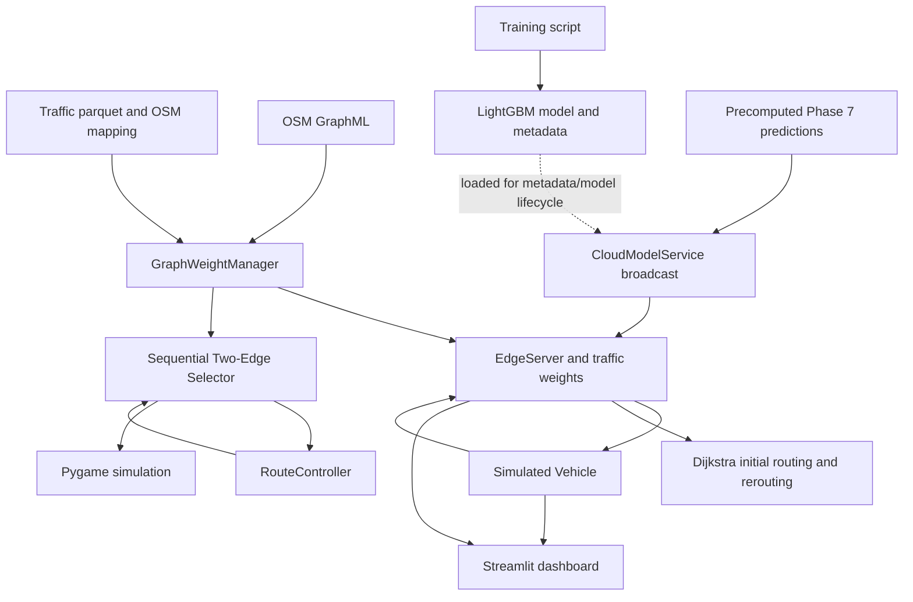

# GeoPulse

GeoPulse is an academic prototype for traffic-aware route planning on real OpenStreetMap road networks. It combines a historical LightGBM speed-prediction experiment, traffic-weighted road costs, a sequential Two-Edge Selection router, rerouting experiments, and local simulation and dashboard demonstrations.

The repository is a local research prototype. It does not currently provide a production fleet service or the original synopsis's full WebSocket, Redis, PostGIS, FastAPI, Leaflet, and Docker deployment stack.

## Current implementation

- **Road data:** Bhubaneswar GraphML with 18,260 nodes and 46,679 directed edges; a separate Jaipur graph is also present.
- **Traffic data:** 275,800 rows across 700 segments, plus a 700-row traffic-to-OSM mapping.
- **Prediction:** A trained LightGBM artifact and metadata are present. The Cloud service loads the artifact, while its current broadcast reads precomputed predictions from `results/phase7_predictions.parquet`; it does not run live inference from incoming feature rows.
- **Routing:** Dijkstra and A* baselines, candidate generation, greedy/destination-aware/lookahead strategies, and a sequential route controller are implemented. The selector is the normal decision path. Cycle recovery can follow a Dijkstra subroute to the destination when the sequential path repeats nodes.
- **Dynamic rerouting:** Offline replay, a synchronous Edge Server/Vehicle prototype, and dashboard scenarios exercise threshold-gated rerouting. There is no live vehicle or sensor transport.
- **Demonstrations:** A Streamlit dashboard and Pygame simulator are available. The Pygame controller calls the selector directly and does not use the `RouteController` safety and threshold logic.
- **Verification:** The project tests and the current audit's real-network checks are recorded in [the complete project report](GEOPULSE_COMPLETE_PROJECT_REPORT.md).

## Architecture



## Technology stack

Python 3.13, NetworkX, OSMnx, pandas, NumPy, DuckDB, PyArrow, LightGBM, scikit-learn, custom Dijkstra/A* and sequential routing code, Streamlit, Pygame, Matplotlib, and pytest.

## Install

From the repository root, create a Python 3.13 environment and install the pinned dependencies:

```powershell
py -3.13 -m venv .venv
.\.venv\Scripts\Activate.ps1
python -m pip install --upgrade pip
python -m pip install -r requirements.txt
```

The model, GraphML files, parquet files, and mapping tables are already stored in this repository. No database server is required by the current prototype.

## Run

Run the test suite:

```powershell
python -m compileall -q src tests scripts
python -m pytest -q -p no:cacheprovider tests
```

Launch the Streamlit dashboard:

```powershell
python -m streamlit run scripts/run_phase11_dashboard.py
```

Launch the Pygame simulator on the demonstration grid or the Bhubaneswar OSM graph:

```powershell
python -m src.pygame_simulation.main --network custom --strategy destination_aware
python -m src.pygame_simulation.main --network osm --strategy lookahead_2
```

Run the existing experiments and replay scripts:

```powershell
python scripts/run_two_edge_experiments.py
python scripts/run_phase8_evaluation.py
python scripts/run_phase9_replay.py
python scripts/run_phase10_ablation.py
python scripts/run_phase11_demo.py
```

These commands can regenerate files under `results/`. Existing experiment outputs are historical artifacts; consult the report before treating them as current performance measurements.

## Reports

- [Complete project audit and readiness report](GEOPULSE_COMPLETE_PROJECT_REPORT.md)
- [Cleanup manifest](GEOPULSE_CLEANUP_MANIFEST.md)
